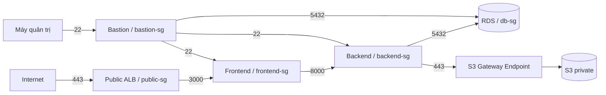

# Từ yêu cầu ứng dụng đến thiết kế AWS và Security Group

## 1. Bắt đầu từ dự án

English Learning App có giao diện Next.js, API FastAPI và PostgreSQL. Người học cần đăng nhập, học bài, làm quiz, lưu flashcard và theo dõi tiến độ. Backend xác thực, xử lý nghiệp vụ và lưu dữ liệu; frontend hiển thị và proxy API cùng origin. API ảnh/logo đọc object từ kho lưu trữ. AI và OAuth là các tích hợp tùy chọn của backend.

Đây là các chức năng phần mềm để phân tích trước khi chọn cách triển khai. Ứng dụng có thể chạy local; tên SG hay tài nguyên AWS không phải điều kiện để xây dựng chức năng.

## 2. Suy ra yêu cầu hạ tầng

Cần một điểm vào HTTPS cho người học, môi trường chạy riêng giao diện và API, PostgreSQL lưu dữ liệu độc lập với vòng đời EC2, kho ảnh và đường quản trị. Frontend cần gọi API backend. Backend cần gọi PostgreSQL và đọc ảnh; frontend không cần đọc object S3. Quản trị viên cần SSH hai máy và kết nối PostgreSQL để kiểm tra/khởi tạo dữ liệu.

## 3. Chọn tài nguyên AWS đáp ứng yêu cầu

Chọn Public ALB cho HTTPS, EC2 frontend chạy cổng 3000, EC2 backend chạy cổng 8000, RDS PostgreSQL cổng 5432, S3 private cho ảnh và Gateway Endpoint cho đường đọc S3 của backend. Bastion làm điểm vào quản trị. Các cổng 3000/8000 đến từ cấu hình ứng dụng; 5432 đến từ PostgreSQL, không do SG đặt ra.

Frontend và backend dùng private IP/DNS trong VPC. ALB là điểm vào của người học. Frontend chỉ gọi backend; backend đọc ảnh từ S3. Quyền truy cập và thông tin bí mật được tách theo vai trò.

## 4. Thiết kế SG sau khi có ma trận kết nối

Từ từng nguồn → đích → cổng, phân nhóm tài nguyên thành `public-sg`, `frontend-sg`, `backend-sg`, `db-sg`, `bastion-sg`. Rule inbound của tầng đích tham chiếu SG của tầng nguồn. Backend có outbound HTTPS tới prefix list S3; IAM role và endpoint/bucket policy giới hạn object đọc được. Các rule được suy ra như sau:

| Đích | Cổng TCP | Nguồn hoặc đích được phép | Nhu cầu |
| --- | --- | --- | --- |
| `public-sg` inbound | 443 | Internet | Người học truy cập HTTPS |
| `frontend-sg` inbound | 3000 | `public-sg` | ALB gọi Next.js và health check |
| `backend-sg` inbound | 8000 | `frontend-sg` | Frontend proxy API |
| `db-sg` inbound | 5432 | `backend-sg` | Ứng dụng lưu dữ liệu |
| `bastion-sg` inbound | 22 | IP quản trị `/32` | Quản trị đăng nhập Bastion |
| `frontend-sg`, `backend-sg` inbound | 22 | `bastion-sg` | Quản trị hai EC2 |
| `db-sg` inbound | 5432 | `bastion-sg` | Quản trị PostgreSQL |
| `backend-sg` outbound | 443 | Managed prefix list S3 | Backend đọc ảnh qua Gateway Endpoint |

Các SG nguồn cho phép outbound tương ứng với từng kết nối ở trên. SG stateful tự cho phép phản hồi. Gateway Endpoint gắn với route table backend và không có SG riêng. Frontend không có đường gọi S3; nếu bật AI/OAuth, backend cần thêm HTTPS egress tới nhà cung cấp.

S3 là dịch vụ ngoài VPC; Gateway Endpoint cung cấp đường truy cập từ backend. SG giới hạn mạng, còn IAM/bucket policy giới hạn quyền đọc object. ALB sử dụng public subnet; hai EC2 và RDS dùng mạng private. Chi tiết subnet/AZ và khả năng dự phòng là quyết định triển khai riêng.

Tham khảo: [SG của ALB và target](https://docs.aws.amazon.com/elasticloadbalancing/latest/application/load-balancer-update-security-groups.html), [S3 Gateway Endpoint](https://docs.aws.amazon.com/vpc/latest/privatelink/gateway-endpoints.html).

Cách lập luận khi báo cáo: “Sau khi xây dựng các chức năng và xác định luồng giao diện → API → dữ liệu, dự án lựa chọn hạ tầng AWS và thiết kế năm nhóm bảo mật để giới hạn quyền kết nối giữa các thành phần.”

## 5. Kiểm chứng thiết kế bằng hành vi ứng dụng

Kiểm HTTPS và target frontend; gọi API từ frontend; xác nhận backend đọc/ghi RDS và lấy ảnh từ S3; SSH qua Bastion và kết nối PostgreSQL quản trị. Restart backend để kiểm dữ liệu/phiên còn lưu. Mỗi kết quả cần gắn với luồng và rule tương ứng. Sơ đồ thiết kế không phải bằng chứng tài nguyên đã cấu hình đúng; ghi kết quả thực tế trong biên bản triển khai.
